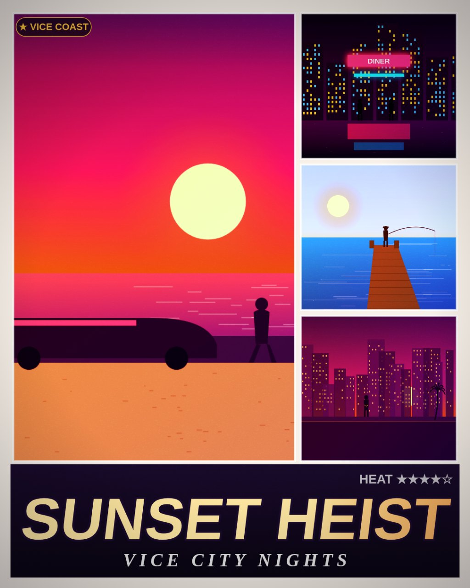

# Vice Coast — Cover Studio

A gta6-cover-art-01 entry: an offline web app that turns any photo and a caption
into GTA 6-style multi-panel cover art, exported as a PNG to share.



## What it does

- **Six layouts** — Hero + Three, Nine-Panel Mosaic, Full-Bleed Hero, Tilted
  Snapshots, Split Duo and Comic Strip. One photo can fill every panel, or each
  panel can hold a different photo.
- **Any photo** — add your own photos from your machine (never uploaded), or use
  the four built-in demo scenes, painted in code by the app itself. Click a panel
  to select it, then drag on the cover to pan, scroll to zoom, or use the Zoom /
  Shift sliders.
- **Sunset grades** — five gradient-map grades (Sunset, Neon Night, Teal Heat,
  Gold Rush, Mono Noir) with strength and warmth sliders.
- **Caption** — a bold skewed title in four styles (sunset gradient, neon outline,
  white block, gold foil), an italic tracked-out subtitle, a "Vice Coast" corner
  badge and a five-star heat meter.
- **Poster finish** — film grain, vignette, halftone dots on the title block and a
  white poster frame, all toggleable.
- **Fast export** — one click exports a PNG at 1080 × 1080, 1080 × 1350 or
  1920 × 1080, or all three sizes at once.

## Try it

```sh
node serve.ts            # serves app/ at http://localhost:8080
```

Open the page, pick a layout, load the demo scenes (or add your own photos),
type a caption and hit **Export PNG**. Everything runs offline in the browser;
no network request is ever made and photos never leave the machine.

## Screenshots

The app's own drawings, taken in headless Chromium (see `shots.json`):

| File | Shows |
| --- | --- |
| `screenshots/1-cover.jpg` | Exported portrait cover, Hero + Three, Sunset grade |
| `screenshots/2-editor.jpg` | The editor with a photo loaded, Nine-Panel Mosaic |
| `screenshots/3-cover.jpg` | Exported square cover, Nine-Panel Mosaic, Neon Night |
| `screenshots/4-cover-wide.jpg` | Exported wide cover, Tilted Snapshots, Gold Rush |

Screenshot mode is built into the app: `?shot=cover&layout=hero3&title=...`
renders one cover full-window; `?shot=editor` shows the editor.

## How it is built

```
main.ts            entry program: copies app/ + screenshots/ to /output and
                   writes /output/dossier.json with vendor/makefun-app.ts
serve.ts           tiny static server for local development (stdlib only)
app/index.html     editor shell: stage canvas, filmstrip, control panels
app/style.css      editor chrome: dark glass, neon sunset accents
app/src/main.js    editor wiring: state, controls, drag/zoom, export, ?shot=
app/src/cover.js   cover engine: layouts, grades, lettering, grain/vignette
app/src/scenes.js  four demo "photos" painted in code (no external images)
vendor/makefun-app.ts  the kit's dossier library, byte for byte unchanged
shots.json         the four screenshot scenes (query + viewport each)
```

The preview and the export are the same drawing: `renderCover()` draws the
cover onto any 2D canvas, so what you see in the editor is exactly the PNG
you get, at 1080 × 1080, 1080 × 1350 or 1920 × 1080.

The dossier is built with the kit's library:

```sh
mkdir -p out && MAKEFUN_OUTPUT_DIR=out node main.ts
```

Running it twice writes byte-identical output (no timestamps, no randomness).

## Originality

All art is original and drawn in this repository: the demo scenes are painted
by `scenes.js`, the lettering is the system heavy sans with gradient fills and
outlines, and the app ships no font files at all. There is no Rockstar Games
logo, wordmark, official artwork or font anywhere in the entry, and no network
reference in `app/` — every file the page loads lives under `app/`.

## License

MIT — see [LICENSE](LICENSE).
